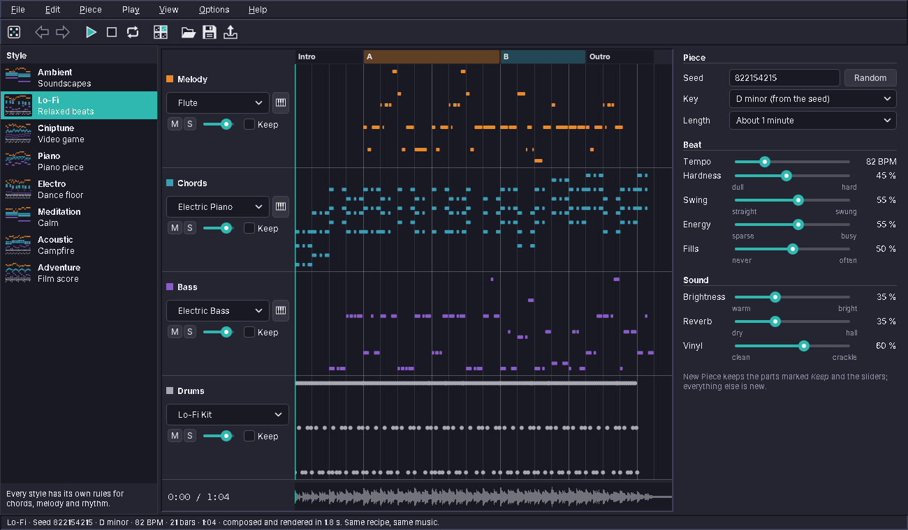

# amade-musicstudio

**amade-musicstudio** is the music generator of the [amadeOS](https://github.com/amadeos-eu/amadeos) desktop. Pick a style, move a few sliders, choose the instruments, and a piece is composed and played. It is all done on this computer, without internet and without samples: every note is composed by rules and every sound is synthesized. The same short recipe always gives the same piece. Built like the other amadeOS applications.




## Features

- **Eight styles**, each with its own rules for scales, chords, melody, bass line and rhythm:
  - *Ambient* (soundscapes), *Lo-Fi* (relaxed beats), *Chiptune* (video game), *Piano* (piano piece)
  - *Electro* (dance floor), *Meditation* (calm), *Acoustic* (campfire), *Adventure* (film score)
- **Four parts**, shown like a piano roll, one lane each: *Melody*, *Chords*, *Bass* and *Drums*. Every lane has:
  - its instrument or drum kit
  - mute (M), solo (S) and volume
  - *Keep*: *New Piece* leaves this part as it is and only writes the others anew
- **Sixteen synthesized instruments** in groups: piano, electric piano, organ, bells, marimba, strings, harp, plucked guitar, flute, warm pad, synth lead, two chip sounds and three basses. Five drum kits: none, soft, electronic, lo-fi and chip.
- **Nine sung voices** without words, synthesized like the instruments: a man, a woman and a child singing *ooh* or *aah*, and a choir of six singing *ooh*, *aah* or humming. Every voice can sing every part.
- **The instrument chooser** (the keyboard button of a lane) describes each instrument, shows its waveform and lets you try it on a two-octave keyboard, with the mouse or the computer keys A to L. Attack, release and octave can be set there too.
- **The recipe** on the right:
  - seed (0 to 999 999 999), key (or the key the seed gives) and length (30 seconds to 5 minutes)
  - *Beat*: tempo, hardness (dull to hard), swing, energy (sparse to busy), fills, variety (steady to changing)
  - *Sound*: brightness, reverb (dry to hall), vinyl crackle
  - Changing only the sound or a volume mixes the piece again without composing it anew, which is almost immediate.
- **Parts that rest and come back**: with more *variety*, melody, bass and drums come in later and rest for some bars, while the chords carry on. The drums answer: a roll before they return, a last hit when they stop, a short fill and a crash when another part comes in.
- **New Piece** (Ctrl+N, the die on the toolbar): new notes for all parts that are not kept; style, sliders and instruments stay. *Random Seed* (Ctrl+R) changes all parts.
- **Variations** (Ctrl+G): eight relatives of the piece (other melody, chords, bass line or drums; faster, slower, harder, softer). Listen to each, then take one.
- **History** of the last fifty pieces: *Back* and *Forward* (Alt+Left/Right, Ctrl+Z/Ctrl+Y).
- **Playing**: Space plays and pauses, Ctrl+Home stops, Ctrl+L repeats. A click on a lane or the waveform jumps there.
- **Export** (Ctrl+E):
  - *WAV* and *FLAC* (lossless, written by Music Studio itself), *OGG Vorbis* (through the GStreamer tools)
  - *MOD*: a tracker module with eight channels and the synthesized instruments as samples, for tracker programs and old computers
  - *MIDI*: the notes only, one track per part, for notation programs and other instruments
  - Options: as a seamless loop (no intro and outro), the four parts as separate files besides the whole piece (for WAV, FLAC and OGG), and the recipe inside the file.
- **Files**: *Save Recipe* writes a small text file (`.musicrecipe`). Every exported file keeps the recipe too, so opening a WAV, FLAC, OGG, MIDI or MOD file made by Music Studio brings the piece back. *Copy Recipe* puts it on the clipboard as one line, to share it in a mail; *Paste Recipe* reads it back. A file given on the command line is opened.
- Composing takes milliseconds; the sound is rendered in the background on all processor cores, so the window stays responsive. A new change cancels the piece that is no longer wanted.
- Five languages (English, Deutsch, Français, Español, Italiano), following the amadeOS desktop language; *Options → Language* overrides it.
- Theme colours, look and toolbar buttons from [amade-commons](https://github.com/amadeos-eu/amade-commons). The toolbar icons are drawn in Java2D, so no icon theme is needed.

## Architecture

Java 25, Swing and Guice, built like [amade-artstudio](https://github.com/amadeos-eu/amade-artstudio). Theme, language and start-up come from `AmadeApplication` in amade-commons. Packages, key decisions and flows are described in [ARCHITECTURE.md](ARCHITECTURE.md).

## Build and run

```sh
./gradlew run                              # start
./gradlew run --args=calm.musicrecipe      # open a recipe, or a file exported by Music Studio
./gradlew test                             # Swing tests need a display: xvfb-run ./gradlew test
./gradlew deb                              # build/distributions/amade-musicstudio_<version>_all.deb
./gradlew installToAmadeOs                 # the .deb into ../amadeos/config/packages.chroot/ for the ISO build
./gradlew windowsInstaller                 # on Windows: MSI with its own Java runtime (needs WiX Toolset 3)
./gradlew windowsInstaller -PinstallerType=app-image   # portable folder with amade-musicstudio.exe
```

OGG export needs `gst-launch-1.0` with the Vorbis encoder (Debian packages `gstreamer1.0-tools` and `gstreamer1.0-plugins-base`); the package recommends them. All other formats need nothing outside Java.

If `../amade-commons` is checked out next to this repository, Gradle builds against that checkout instead of the JitPack version.

## Planned

- More styles and drum kits
